<!--
  Every graphic on this page is hand-built SVG in /assets,
  rendered by scripts/build_assets.py and refreshed daily by
  .github/workflows/update-profile.yml. Edit the CONTENT block in the script, not the SVGs.
-->


  

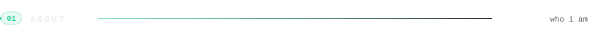

  

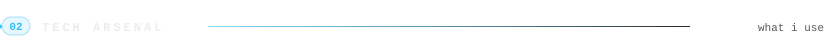

  

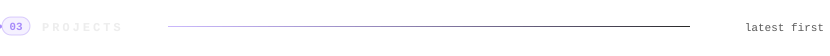
<!--PROJECTS:START-->
<!--PROJECTS:END-->

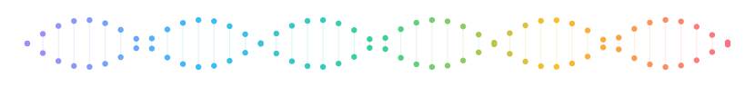


  

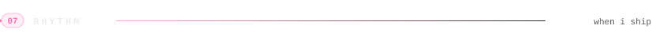

<picture>
  <source media="(prefers-color-scheme: dark)" srcset="https://raw.githubusercontent.com/Sahitya0805/Sahitya0805/output/snake-spectrum.svg" />
  <source media="(prefers-color-scheme: light)" srcset="https://raw.githubusercontent.com/Sahitya0805/Sahitya0805/output/github-contribution-grid-snake.svg" />
  
</picture>

  

<a href="https://github.com/Sahitya0805?tab=achievements"></a>
<a href="https://cloud.layer5.io/user/55ff6b45-c08f-4ede-9cb3-27cc86a92616?tab=badges&badge=first-design"></a>

  

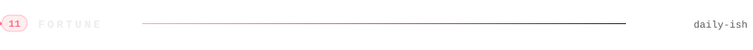

  


